  

# Awesome Enterprise Question & Answer Platform 🚀

  
  
  
  
  

---

## 📌 Top Enterprise Question & Answer Platform Ecosystem

> **Curated List of Enterprise SaaS Platforms, Open-Source Q&A Systems, and Self-Hosted Knowledge Bases**  
> *Targeted at Enterprise Knowledge Sharing, Employee Q&A Communities, Internal Helpdesks, and AI-Powered Retrieval Engines.*  
> **Last updated: March 2026**

This repository tracks top-tier **SaaS platforms** and **open-source projects** in the **Enterprise Question & Answer Platform** landscape. These solutions enable organizations to capture institutional and tribal knowledge through structured Q&A workflows—eliminating repetitive inquiries, surfacing expert answers, and building searchable, scalable internal knowledge repositories.

🔍 **Key Search & Evaluation Topics**: Enterprise Q&A, Knowledge Base Software, Stack Overflow for Teams Alternatives, Internal Support Forums, Retrieval-Augmented Generation (RAG) Q&A, Self-Hosted Community Engines, Tribal Knowledge Capture.

---

## 📑 Table of Contents
- [📊 Sector Overview & Market Dynamics](#-sector-overview--market-dynamics)
- [☁️ SaaS & Hosted Platforms](#️-saas--hosted-platforms)
- [🔓 Open-Source GitHub Projects](#-open-source-github-projects)
- [🛠️ Architectural Guidance & Selection Matrix](#️-architectural-guidance--selection-matrix)
- [🤝 How to Contribute](#-how-to-contribute)
- [💖 Support & Sponsorship](#-support--sponsorship)
- [📈 Star History](#-star-history)
- [⚖️ Disclaimer](#️-disclaimer)

---

## 📊 Sector Overview & Market Dynamics

The global enterprise knowledge management and Q&A software market is currently estimated between **$14B and $17B**, expanding at a compound annual growth rate (**CAGR of 14% to 18%**) toward **$37B+ to $70B+** over the next decade, propelled by advancements in LLMs, RAG pipelines, and conversational workplace search. 

The sector is **moderately fragmented**:
* **Enterprise Conglomerates & Incumbent Platforms:** Tech giants (such as Cisco via Webex/Slido, Microsoft via SharePoint/Copilot/Teams, and Salesforce via Slack) command vast portions of broad communication budgets.
* **Specialized Q&A & Knowledge Point Solutions:** Highly focused vendors (such as Stack Overflow for Teams, Bloomfire, and Capacity) compete vigorously for dedicated institutional knowledge capture, expert discovery, and AI-verified internal answers.

---

## ☁️ SaaS / Hosted Platforms

| Product | Description | Company Size (Valuation / Revenue) | Pricing (Starting Tier) | Free Tier / Trial Limits |
|---------|-------------|------------------------------------|-------------------------|--------------------------|
| **[Slido](https://www.slido.com/)** | 🎤 Live Q&A and polling for meetings and events. Built for real-time audience engagement during presentations, all-hands, and webinars. Integrated into Cisco Webex. | **$370B–$400B market cap** / **$63.3B FY26 rev** (Parent: Cisco Systems) | **$12.50/month** ($150/year billed annually, Engage Plan; or $375 one-time event) | **Free forever plan**: Up to 100 participants per event, 3 polls, and 1 quiz per event |
| **[Zoho Connect / Learn](https://www.zoho.com/)** | 🏢 Internal collaboration, knowledge management, employee training, and structured Q&A manuals within the Zoho ecosystem. | **~$12.5B valuation** / **~$1.4B–$1.5B annual rev** (Zoho Corporation) | **$1.00/user/month** (Starter/Express plan billed annually) | **Free forever plan**: Supports up to 5 users, 3 spaces, 5 manuals, 5 courses, 1 GB storage (also includes 7-day to 15-day full trials) |
| **[Stack Overflow for Teams](https://stackoverflow.co/teams/)** | 💡 **The enterprise Q&A standard.** Brings the Stack Overflow model inside your company—employees ask questions, colleagues answer, and peer voting surfaces verified solutions. | **$1.8B acquisition valuation** / **~$115M annual rev** (Parent: Prosus) | **$6.50/user/month** (Basic tier, billed annually) | **Free forever plan**: Free for up to 50 users (Basic features) |
| **[Capacity](https://capacity.com/)** | 🤖 AI-powered knowledge and support automation platform. Combines an internal knowledge base with an AI assistant that answers questions from connected systems. Acquired Starmind in March 2026. | **~$238M+ funding raised** / **~$100M ARR** | **$2,000/month** (~$25,000/year base platform subscription + usage-based AI interactions) | **Free trial**: 30-day proof-of-concept / pilot trial via sales inquiry (no self-serve free plan) |
| **[Bloomfire](https://www.bloomfire.com/)** | 📚 Enterprise knowledge engagement platform with Q&A, deep indexing, and community features for enterprise knowledge hubs. | **~$50M–$100M valuation** / **~$7M–$12M annual rev** ($32.8M total funding) | **$500/month** (~$6,000/year for entry-level Team package) | **Free trial**: 14-day to 30-day guided proof-of-concept / demo pilot via sales (no self-serve free plan) |
| **[Starmind](https://www.starmind.com/)** | 🧠 AI-powered knowledge network that connects employees to human experts in real time. Acquired by Capacity in March 2026. | **~$22.2M total funding** (Acquired by Capacity, $100M ARR) / **~$5.4M–$14.6M rev** | **$0.60/user/month** (Expert Finder modular tier; base enterprise suite from ~$4,000/month) | **Free trial**: Scoped enterprise pilot / proof-of-concept trial via sales (no self-serve free plan) |

---

## 🔓 Open-Source GitHub Projects

Curated list of self-hosted enterprise Q&A engines, community platforms, collaborative documentation wikis, and AI RAG knowledge systems. **Sorted descending by GitHub Stars_Counts**.

| Project | GitHub_Stars | Description | Stack & Deployment |
|---------|-------|-------------|-------------------|
| **[Discourse](https://github.com/discourse/discourse)** |  | 💬 **The modern standard for open-source discussion forums and community Q&A.** Features accepted solutions, badges, voting plugins, AI chat summaries, and fine-grained permissions. | Ruby on Rails, Ember.js, PostgreSQL, Redis • Docker |
| **[Outline](https://github.com/outline/outline)** |  | 📝 **Fast, collaborative enterprise knowledge base and team wiki.** Features real-time Markdown editing, deep search, Slack integrations, and SSO. Excellent companion for internal team Q&A docs. | TypeScript, Node.js, React, PostgreSQL • Docker Compose |
| **[Onyx (formerly Danswer)](https://github.com/onyx-dot-app/onyx)** |  | 🤖 **Open-source GenAI platform for enterprise question-answering.** Connects to Slack, GitHub, Confluence, Google Drive, Notion, and Jira. Answers natural-language queries backed by quotes and source links. | Python, FastAPI, React, Vespa/PostgreSQL • Docker / K8s |
| **[Wiki.js](https://github.com/requarks/wiki)** |  | 📖 **Extensible and modern open-source wiki software.** Supports Markdown, visual, and code editors, multi-lingual localization, enterprise auth (SAML, LDAP, OAuth), and full-text search. | Node.js, Vue.js, PostgreSQL/MySQL/SQLite • Docker |
| **[Docmost](https://github.com/docmost/docmost)** |  | 📄 **Open-source collaborative wiki and documentation software.** Built as an open alternative to Notion and Confluence with real-time multiplayer editing, page nesting, and spaces. | TypeScript, NestJS, React, PostgreSQL, Redis • Docker |
| **[BookStack](https://github.com/BookStackApp/BookStack)** |  | 📚 **Simple, self-hosted, easy-to-use platform for organizing and storing documentation and Q&A guides.** Organized into Books, Chapters, and Pages with granular role-based permissions. | PHP, Laravel, MySQL • Docker / Native Linux |
| **[Apache Answer](https://github.com/apache/answer)** |  | 💡 **Top-Level Apache Project and the primary open-source Stack Overflow alternative.** Dedicated Q&A community platform with reputation gamification, voting, tags, plugin ecosystem, and lightweight resource usage (<256MB RAM). | Go, React, SQLite/MySQL/PostgreSQL • Single-command Docker |
| **[NodeBB](https://github.com/NodeBB/NodeBB)** |  | 🌐 **Next-generation community forum software built on Node.js.** Offers real-time notifications, mobile responsiveness, Q&A question-and-answer resolution plugins, and RESTful APIs. | Node.js, Redis / MongoDB / PostgreSQL • Docker |
| **[Question2Answer](https://github.com/q2a/question2answer)** |  | ⚡ **The veteran open-source Q&A engine deployed on 24,500+ sites across 40 languages.** Features fast search, categories, points-based karma, comments, and WordPress integrations. | PHP, MySQL • 5-Minute LAMP setup |
| **[Scoold](https://github.com/Erudika/scoold)** |  | 🎯 **Lightweight Stack Overflow clone for teams.** Supports internal enterprise knowledge sharing, tagging, reputation systems, and webhook integrations with Para backend. | Java, Para backend • Docker / Cloud |
| **[Brimming](https://github.com/Tight-Line/brimming)** |  | 🔎 **Self-hosted Stack Overflow-like knowledge base with AI capabilities.** Combines Q&A with articles, hybrid vector/keyword search, AI FAQ synthesis, and LDAP/AD SSO. | Ruby on Rails, PostgreSQL, pgvector • Docker |

---

## 🛠️ Architectural Guidance & Selection Matrix

When selecting or architecting an enterprise knowledge sharing system, align on your organization's core interaction model:

* 👥 **Structured Community Q&A (Stack Overflow Model):**  
  *Choose:* **[Apache Answer](https://github.com/apache/answer)** (Modern Go/React, lightweight, plugin-driven) or **[Stack Overflow for Teams](https://stackoverflow.co/teams/)** (SaaS standard).
* 🤖 **AI-Powered Retrieval over Distributed Documents (RAG Model):**  
  *Choose:* **[Onyx](https://github.com/onyx-dot-app/onyx)** (Open-source AI connectors over Slack, Confluence, Jira) or **[Capacity](https://capacity.com/)** (Enterprise AI automation).
* 📝 **Long-Form Documentation & Knowledge Base Wikis:**  
  *Choose:* **[Outline](https://github.com/outline/outline)**, **[Wiki.js](https://github.com/requarks/wiki)**, **[BookStack](https://github.com/BookStackApp/BookStack)**, or **[Docmost](https://github.com/docmost/docmost)**.
* 💬 **Broad Conversational Forums with Q&A Support:**  
  *Choose:* **[Discourse](https://github.com/discourse/discourse)** or **[NodeBB](https://github.com/NodeBB/NodeBB)**.

---

## 🤝 How to Contribute

Contributions are welcome! To propose additions or updates:

1. 🍴 Fork this repository.
2. ✍️ Add or refine entries in `README.md` following the existing format.
3. 🔗 Ensure all URLs, Stars_Badges, and pricing tiers are accurate and verifiable.
4. 🚀 Submit a Pull Request with a concise summary of changes.

---

## 💖 Support & Sponsorship

Thank you for exploring and bookmarking this repository! 🙏 If you find this curated ecosystem directory useful for your team or organization, please consider supporting the project:

- ⭐ **Star this repository** to help others discover it.
- 🍴 **Fork and share** it with colleagues and DevOps teams.
- ☕ **Buy me a coffee / Sponsor**: If you'd like to support ongoing curation and open-source tooling, check out the [GitHub Sponsor Dashboard](https://github.com/sponsors/ishandutta2007).

---

## 📈 Star History

---

## ⚖️ Disclaimer

- This is a **community-curated directory** intended for educational and architectural evaluation purposes. Mention of proprietary products does not constitute an endorsement.
- Enterprise Q&A systems frequently handle confidential business knowledge and internal discussions; ensure adequate access controls, SSO/SAML governance, and compliance with data privacy regulations (e.g., GDPR, SOC2) prior to production deployment.

---

  <b>Built for knowledge managers, engineering teams, and organizations building scalable internal knowledge platforms.</b> 
  Let's make enterprise Q&A platforms more accessible, searchable, and community-driven.

